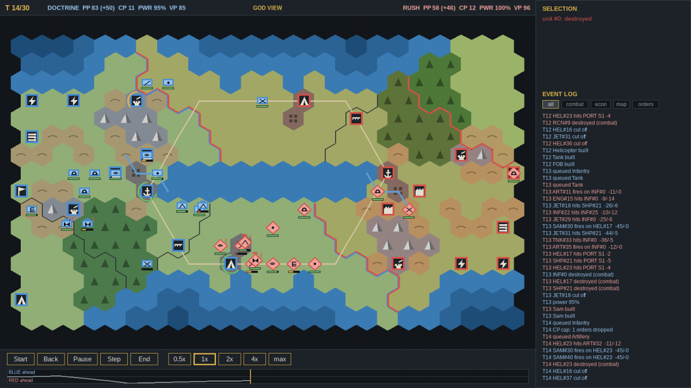
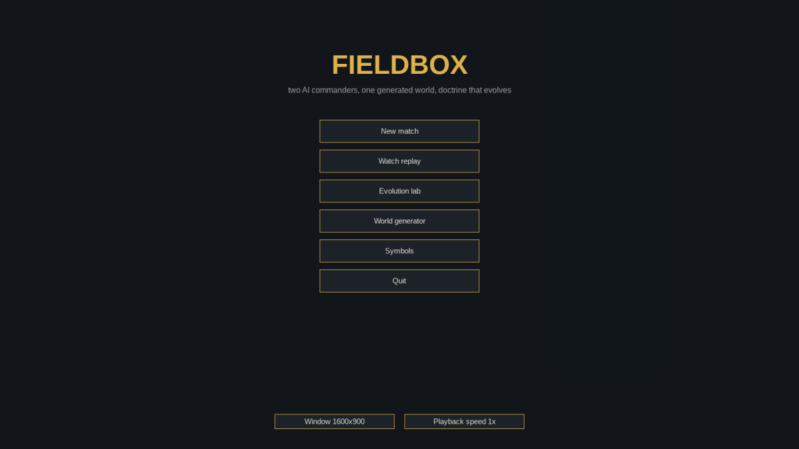
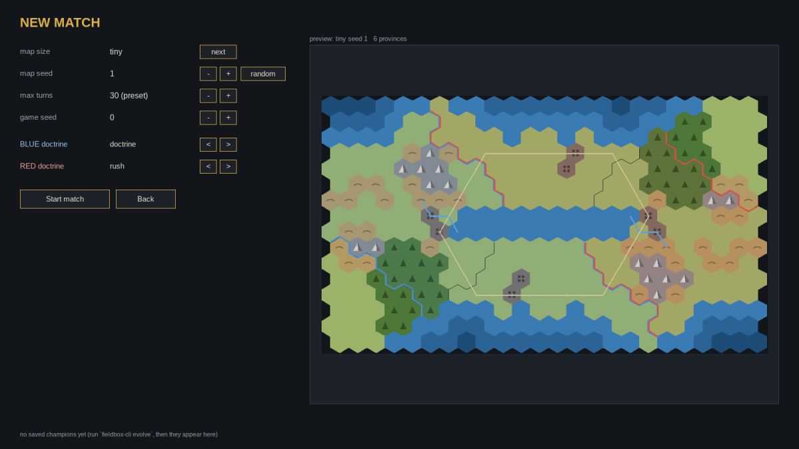
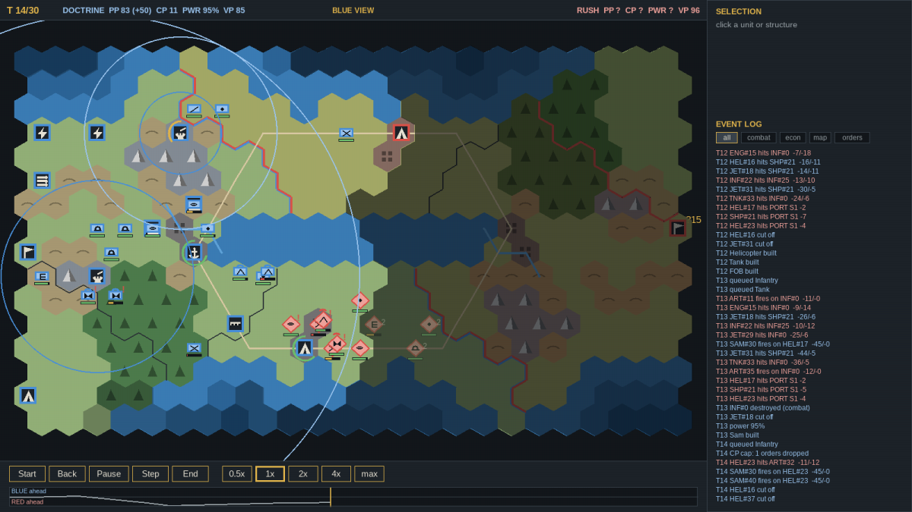
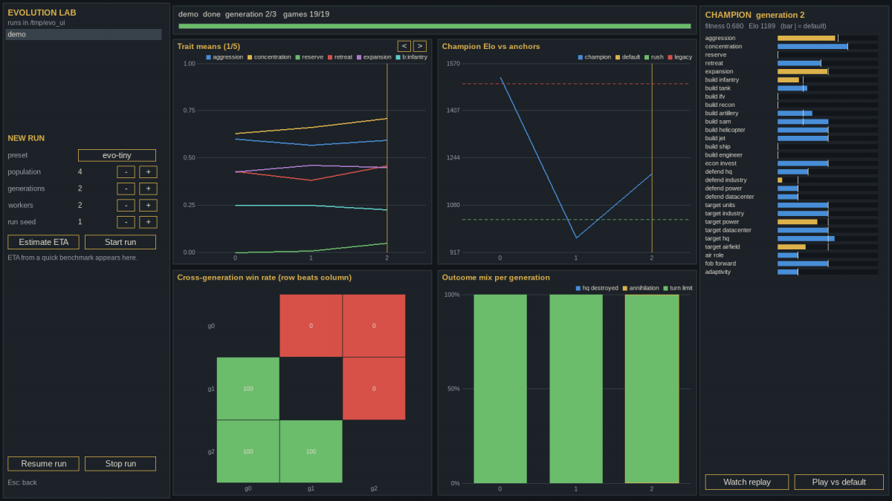

# Fieldbox

Two AI commanders, BLUE and RED, fight over a randomly generated world
across land, sea and air. Each side runs an economy and infrastructure:
headquarters, industry, power plants, a data center, radar sites, airfields,
ports and forward bases. Think RISK crossed with chess: provinces and income,
discrete simultaneous turns, and every piece with a clear role.

The point is to **watch the AI adapt**. Each commander's doctrine is a set of
traits (aggression, force mix, what to protect, what to target). A population
of doctrines evolves through league play, and commanders counter-build
against what they observe within a match.



## Run it

The engine needs only Python 3.10+ and the standard library. The window needs
`pygame-ce`.

```bash
python -m venv .venv && . .venv/bin/activate
pip install -e ".[ui]"
fieldbox                   # opens the main menu
fieldbox-cli play --watch  # one match as an animated ASCII map, no window
```

The menu has **New match** (map size, seed with a preview, turn limit, and a
doctrine for each side), **Watch replay**, **Evolution lab**, **World
generator** and **Symbols**. Window size and playback speed are saved in
`~/.config/fieldbox/settings.json`.




### Command line

```bash
fieldbox-cli play --blue doctrine --red rush --seed 3 --save match.fbr
fieldbox-cli tournament --games 10 --preset tiny    # round robin with Elo
fieldbox-cli report --games 20                      # batch diagnostics and anomaly flags
fieldbox-cli bench                                  # engine throughput
fieldbox-cli gui --screen match --replay match.fbr  # watch a saved replay
fieldbox-cli evolve --preset evo-standard --bench   # time the games and print the ETA
fieldbox-cli evolve --preset evo-standard --run main --seed 1 --resume
```

Without installing, use `python -m fieldbox ...` instead of `fieldbox-cli ...`.
Agents: `doctrine` (the default commander), `doctrine-legacy`, `rush`, `hold`,
`random`, and `champion:<run>:<generation>` for a saved evolution champion.

### Viewer keys

Match viewer: `Space` play/pause, `Left`/`Right` step, `Home`/`End` first/last
turn, `+`/`-` speed, click a unit or structure to inspect it, drag the
timeline to scrub, wheel over the right panel scrolls the log, `F` cycles God /
BLUE / RED view (fog of war), `R` radar range rings, `Z` fit, `G` grid, `P`
province tint, `O` or `Enter` toggles the end overlay, `Esc` goes back.



## How it works

- **World.** A generated, point-symmetric hex map (rivers, roads, terrain,
  provinces, structures). BLUE holds the west half and RED the east half,
  so the map is fair by construction.
- **Turns.** Both sides give orders, then the turn resolves at once (WEGO):
  movement, simultaneous combat, captures, supply, economy, victory.
  Command points (from the HQ and the data center, scaled by power) limit how
  many new orders a side can give.
- **Economy and war.** Provinces and industry produce production points that
  buy units; power, supply lines and radar couple the infrastructure. A match
  ends by destroying the enemy HQ, by annihilation, or on victory points at the
  turn limit.
- **Fog of war.** Each side sees only what its units, structures and radar
  see. Lost contacts linger as ghosts; seen structures stay on the map until
  seen destroyed.
- **Two-layer commander.** The strategic layer scores objectives with the
  genome's weights, picks a main and a secondary effort, keeps garrisons,
  plans builds and counter-builds against what it sees. The tactical layer
  carries each unit's task out.
- **Doctrine genome.** 36 traits in [0, 1]: aggression, concentration,
  reserve, retreat threshold, expansion, a build weight per unit type,
  what to defend, what to target, air role, forward bases, adaptivity.

### Evolution

`evolve` runs competitive co-evolution. Every generation, each genome plays
peers from the same population, members of a hall of fame of past champions,
and fixed anchors (the default commander, the old doctrine agent and a rush
agent), on fresh maps each generation, so doctrines cannot memorise a map.
Fitness is win/draw/loss plus a small victory-point margin bonus. The next
generation comes from elites, tournament selection, crossover and mutation. The
champion's Elo is measured against the anchors, and at the end champions from
across the run play each other, which shows whether progress is real or just a
cycle.

A run is reproducible whatever the number of workers, and can be resumed after
an interruption. The Evolution lab shows trait drift, champion Elo, the
cross-generation win-rate matrix and the outcome mix, and lets you watch a
champion's replay or play against it.



A full run (`evo-standard`: 16 genomes, 40 generations) takes roughly an hour
and a half on a 6-core machine. To use more cores, open
`notebooks/evolve_kaggle.ipynb` on Kaggle or Colab (CPU is enough).

## Tests

```bash
python -m unittest discover -s tests                   # quick
FIELDBOX_SLOW=1 python -m unittest discover -s tests   # full
```

UI tests are skipped when pygame-ce is not installed. All tunable numbers live
in `fieldbox/params.py`, each with a comment.

## Packaging

`packaging/fieldbox.spec` builds a one-folder PyInstaller bundle
(`pyinstaller packaging/fieldbox.spec`). The release workflow builds a Linux
AppImage and a Windows zip, and only runs on version tags or when started by
hand.

## Research basis

Ideas this project borrows, from the literature on population-based and
league training:

- Rosin & Belew (1997), *New methods for competitive coevolution*: the hall of
  fame, so old strategies are not forgotten.
- Vinyals et al. (2019), *Grandmaster level in StarCraft II using multi-agent
  reinforcement learning*: training against a mix of current, past and fixed
  opponents.
- Jaderberg et al. (2019), *Human-level performance in 3D multiplayer games with
  population-based reinforcement learning*: evolving behaviours inside a
  population.
- Baker et al. (2020), *Emergent tool use from multi-agent autocurricula*:
  successive counter-strategies, the pattern the cross-generation view looks for.
- Czarnecki et al. (2020), *Real world games look like spinning tops*: why the
  cross-generation matrix is checked for cycles instead of trusting fitness.

## Licence

MIT
